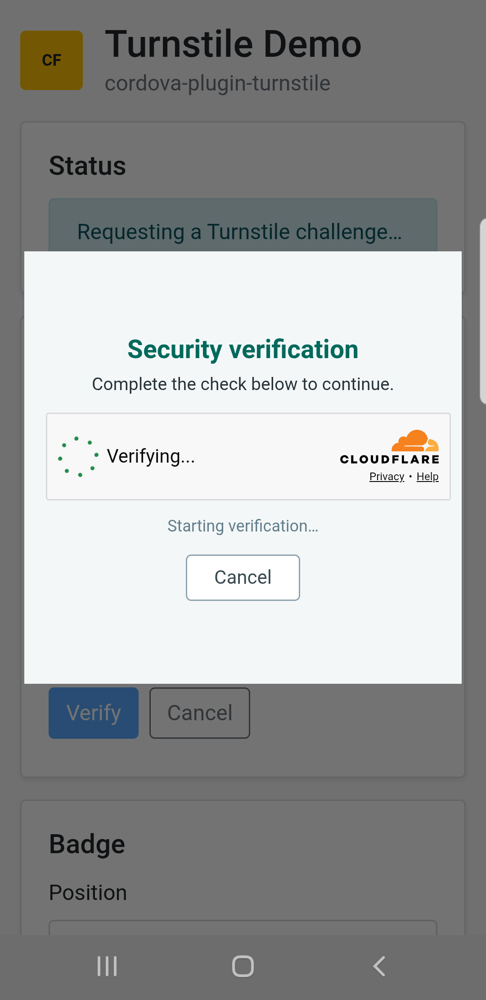
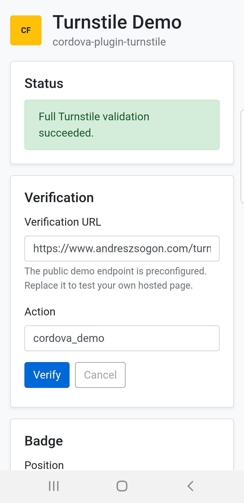

# Turnstile demo

This directory contains the source files for the `cordova-plugin-turnstile` demo and a precompiled Android APK ready for testing.

## Precompiled APK

Download and install [`com.andreszs.turnstile.demo.apk`](com.andreszs.turnstile.demo.apk). It is a debug build intended only for testing and is preconfigured to use the plugin project's public Turnstile demo endpoint.

SHA-256:

```text
2EE5FBF0DBDB4B548DD2759AC4BD2B8FA92CE8BF5B39CE955696E3A7FEEFF320
```

Install it on a connected Android device with:

```shell
adb install -r com.andreszs.turnstile.demo.apk
```

## Build from source

The source deliberately contains no preconfigured verification endpoint URL or Turnstile keys. After building and opening the app, enter your own HTTPS endpoint and matching action. The endpoint used by this demo must serve the Turnstile challenge on `GET` and accept the returned token as JSON on `POST` for server-side validation.

The demo uses cordova-android 14 and the local minified Bootstrap 4 CSS file. It does not load Bootstrap from a CDN and does not include Bootstrap JavaScript or custom CSS.

## Screenshots

<p align="center">
  
  
</p>
