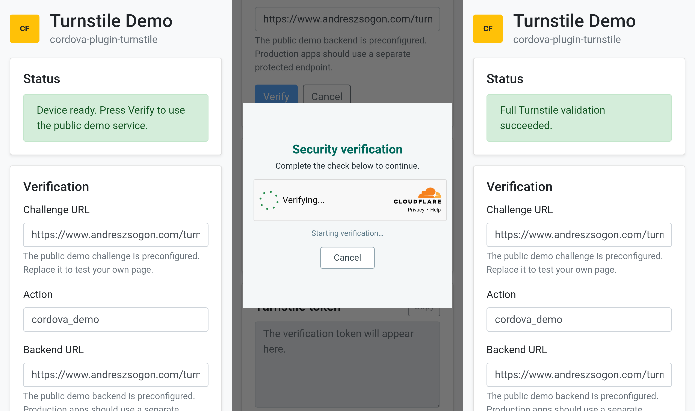

# Turnstile demo

This directory contains the reproducible Cordova Android project for the `cordova-plugin-turnstile` demo.

## Build from source

The source deliberately contains no preconfigured endpoint URLs or Turnstile keys. After building and opening the app, enter:

1. The **Challenge URL** of the hosted page that renders Turnstile with the public site key. Its `action` query parameter must match the Action field.
2. The matching **Action** expected by the challenge page and backend.
3. The separate **Backend URL** that accepts the returned token, validates it with Cloudflare Siteverify, and performs the protected operation.

The backend must allow the Cordova app's exact origin, normally `https://localhost`, respond to CORS preflight `OPTIONS`, and accept the JSON request contract documented by the [plugin server examples](https://github.com/andreszs/cordova-plugin-turnstile/tree/main/server).

Because this interactive demo accepts arbitrary HTTPS URLs, its `config.xml` and CSP allow HTTPS connections broadly. A production app should replace those wildcards with its exact backend origin as documented by the plugin README.

Install the pinned npm dependencies and add the Android platform:

```shell
npm ci
cordova platform add android
```

Then build or deploy the demo:

```shell
npm run build:android
npm run run:android
```

The demo uses the local minified Bootstrap 4 CSS file. It does not load Bootstrap from a CDN and does not include Bootstrap JavaScript or custom CSS.

## Screenshots

<p align="center">
  
</p>
